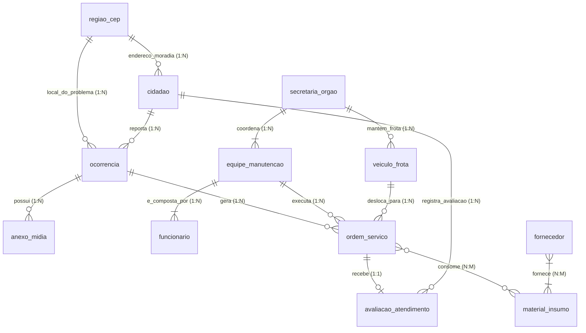

# Especificação Técnica do Sistema: Monitoramento e Manutenção Colaborativa de Infraestrutura Urbana

---

## Etapa 1 - Descrição do Problema e Enquadramento nos ODS

### 1.1. Contexto e Definição do Problema

A gestão da zeladoria e da infraestrutura urbana em municípios de médio e grande porte enfrenta graves deficiências de mapeamento e tempo de resposta. Problemas cotidianos — como buracos no asfalto, postes de iluminação queimados, vazamentos na rede de drenagem, semáforos inoperantes e pontos de descarte irregular de entulho — deterioram a segurança viária e a qualidade de vida dos moradores. Na maioria das prefeituras, o fluxo de comunicação entre o cidadão que identifica o problema e o setor operacional responsável pelo reparo é fragmentado, resultando em chamados duplicados, perda de informações sobre a localização exata e demora na priorização de casos críticos.

Do ponto de vista da administração pública, a ausência de um sistema integrado impede o controle eficiente sobre as equipes de campo, a frota de veículos de manutenção e o estoque de insumos consumidos em cada Ordem de Serviço (como massa asfáltica, lâmpadas LED e tubulações). Propõe-se, portanto, a modelagem de um banco de dados relacional para gerenciar o ciclo completo de manutenção urbana: desde a abertura da ocorrência geolocalizada por CEP pelo cidadão com envio de mídias comprobatórias, passando pelo direcionamento às secretarias e equipes especializadas, até o controle de materiais fornecidos por empresas terceiras e a avaliação final do serviço pela população.

### 1.2. Enquadramento nos Objetivos de Desenvolvimento Sustentável (ODS)

* **ODS 11 (Cidades e Comunidades Sustentáveis):** Enquadra-se diretamente nas **Metas 11.3 e 11.7**, contribuindo para tornar as cidades mais inclusivas, seguras, resilientes e sustentáveis por meio do aprimoramento da gestão participativa, urbanização inclusiva e conservação segura dos espaços públicos.
* **ODS 9 (Indústria, Inovação e Infraestrutura):** Atua de forma complementar ao incentivar o desenvolvimento e a manutenção contínua de infraestruturas municipais confiáveis, sustentáveis e de qualidade para apoiar o desenvolvimento econômico e o bem-estar humano.

---

## Etapa 2 - Especificação do Modelo Entidade-Relacionamento (MER)

### 2.1. Dicionário de Entidades e Atributos (12 Entidades, 70 Atributos)

*(Notação para o diagrama no brModelo: **[PK]** / `●` = Atributo Identificador / Chave Primária; `○` = Atributo Simples; nomenclatura padronizada em `snake_case` minúsculo no singular)*

1. **`regiao_cep`** *(Entidade Forte — 5 atributos)*: Base geográfica para padronização de localização.
   * **Atributos:** `cep` [PK], `cidade`, `bairro`, `logradouro`, `ponto_referencia_regiao`.

2. **`cidadao`** *(Entidade Forte — 6 atributos)*: Morador cadastrado que reporta problemas na infraestrutura e avalia o atendimento.
   * **Atributos:** `id_cidadao` [PK], `cpf`, `nome_completo`, `email`, `telefone`, `numero_residencia`.

3. **`ocorrencia`** *(Entidade Forte — 9 atributos)*: Chamado registrado pelo cidadão detalhando a falha de infraestrutura.
   * **Atributos:** `id_ocorrencia` [PK], `protocolo`, `titulo`, `descricao_detalhada`, `categoria_problema`, `nivel_gravidade`, `data_abertura`, `status_atual`, `numero_aproximado`.

4. **`anexo_midia`** *(Entidade Forte com Dependência Existencial — 4 atributos)*: Arquivos de foto ou vídeo anexados para comprovar a ocorrência.
   * **Atributos:** `id_anexo` [PK], `url_arquivo`, `tipo_midia`, `data_upload`.

5. **`secretaria_orgao`** *(Entidade Forte — 6 atributos)*: Departamento municipal responsável pela gestão das equipes e da frota (ex: Secretaria de Obras, Iluminação, Limpeza).
   * **Atributos:** `id_secretaria` [PK], `nome_secretaria`, `sigla`, `nome_secretario_responsavel`, `telefone_contato`, `orcamento_mensal`.

6. **`equipe_manutencao`** *(Entidade Forte — 5 atributos)*: Time operacional de campo encarregado de executar os reparos.
   * **Atributos:** `id_equipe` [PK], `nome_equipe`, `categoria_problema_atendida`, `turno_trabalho`, `status_disponibilidade`.

7. **`funcionario`** *(Entidade Forte — 6 atributos)*: Servidor ou técnico alocado em uma equipe de manutenção (eletricista, engenheiro, calceteiro).
   * **Atributos:** `matricula_funcionario` [PK], `cpf`, `nome_funcionario`, `cargo_funcao`, `data_admissao`, `telefone_corporativo`.

8. **`veiculo_frota`** *(Entidade Forte — 6 atributos)*: Caminhões e utilitários vinculados às secretarias e usados no deslocamento das equipes.
   * **Atributos:** `placa_veiculo` [PK], `tipo_veiculo`, `modelo`, `ano`, `capacidade_carga`, `status_manutencao`.

9. **`ordem_servico`** *(Entidade Forte — 7 atributos)*: Documento operacional que agenda, mobiliza recursos e registra a execução do reparo.
   * **Atributos:** `id_os` [PK], `data_emissao`, `data_inicio_execucao`, `data_conclusao`, `relatorio_tecnico`, `custo_mao_de_obra`, `status_os`.

10. **`material_insumo`** *(Entidade Forte — 5 atributos)*: Catálogo de materiais de almoxarifado (asfalto frio, lâmpada LED, cimento, tubo PVC).
    * **Atributos:** `id_material` [PK], `nome_material`, `unidade_medida`, `quantidade_estoque_atual`, `custo_unitario_medio`.

11. **`fornecedor`** *(Entidade Forte — 6 atributos)*: Empresas contratadas que fornecem materiais e insumos para a prefeitura.
    * **Atributos:** `id_fornecedor` [PK], `cnpj`, `razao_social`, `telefone`, `email_comercial`, `cidade_sede`.

12. **`avaliacao_atendimento`** *(Entidade Forte — 5 atributos)*: Parecer e nota atribuídos pelo cidadão após a execução da Ordem de Serviço.
    * **Atributos:** `id_avaliacao` [PK], `nota_satisfacao`, `comentario_cidadao`, `problema_resolvido_boolean`, `data_avaliacao`.

---

### 2.2. Especificação de Relacionamentos, Cardinalidades e Atributos de Relacionamento (14 Relacionamentos, 6 Atributos)

*(Padrão de leitura no brModelo: Entidade A `(min, max)` — **Verbo** — `(min, max)` Entidade B)*

| Relacionamento (Losango) | Entidade A | Cardinalidade (A : B) | Entidade B | Atributos Próprios do Relacionamento | Regra de Negócio e Mapeamento |
| --- | --- | --- | --- | --- | --- |
| **endereco_moradia** | `regiao_cep` | **1 : N** `(0,n)` : `(1,1)` | `cidadao` | *Nenhum* | Um CEP localiza vários cidadãos; um cidadão reside em um único CEP. |
| **local_do_problema** | `regiao_cep` | **1 : N** `(0,n)` : `(1,1)` | `ocorrencia` | *Nenhum* | Um CEP pode concentrar várias ocorrências; cada ocorrência ocorre em um CEP específico. |
| **reporta** | `cidadao` | **1 : N** `(0,n)` : `(1,1)` | `ocorrencia` | *Nenhum* | Um cidadão reporta várias ocorrências; uma ocorrência é aberta por um único cidadão. |
| **possui** | `ocorrencia` | **1 : N** `(0,n)` : `(1,1)` | `anexo_midia` | *Nenhum* | Uma ocorrência pode possuir vários anexos; cada anexo pertence a uma única ocorrência. |
| **coordena** | `secretaria_orgao` | **1 : N** `(1,n)` : `(1,1)` | `equipe_manutencao` | *Nenhum* | Uma secretaria coordena várias equipes; cada equipe está subordinada a uma secretaria. |
| **mantem_frota** | `secretaria_orgao` | **1 : N** `(0,n)` : `(1,1)` | `veiculo_frota` | *Nenhum* | Uma secretaria detém vários veículos; cada veículo é alocado a uma secretaria. |
| **e_composta_por** | `equipe_manutencao` | **1 : N** `(1,n)` : `(1,1)` | `funcionario` | *Nenhum* | Uma equipe é composta por vários funcionários; um funcionário atua em uma equipe. |
| **gera** | `ocorrencia` | **1 : N** `(0,n)` : `(1,1)` | `ordem_servico` | *Nenhum* | Uma ocorrência complexa pode gerar mais de uma OS; uma OS atende a uma ocorrência. |
| **executa** | `equipe_manutencao` | **1 : N** `(0,n)` : `(1,1)` | `ordem_servico` | *Nenhum* | Uma equipe executa várias OS ao longo do tempo; cada OS é atribuída a uma equipe. |
| **desloca_para** | `veiculo_frota` | **1 : N** `(0,n)` : `(1,1)` | `ordem_servico` | *Nenhum* | Um veículo realiza deslocamentos para várias OS; cada OS utiliza um veículo principal. |
| **recebe** | `ordem_servico` | **1 : 1** `(0,1)` : `(1,1)` | `avaliacao_atendimento` | *Nenhum* | Uma OS concluída recebe no máximo uma avaliação final do cidadão solicitante. |
| **registra_avaliacao** | `cidadao` | **1 : N** `(0,n)` : `(1,1)` | `avaliacao_atendimento` | *Nenhum* | Um cidadão pode avaliar várias OS que abriu; cada avaliação é feita por um cidadão. |
| **consome** | `ordem_servico` | **N : M** `(0,n)` : `(0,n)` | `material_insumo` | `quantidade_utilizada`, `data_baixa_estoque` | Uma OS consome vários materiais e um material é usado em várias OS (Gera tabela associativa `consumo_material_os`). |
| **fornece** | `fornecedor` | **N : M** `(1,n)` : `(1,n)` | `material_insumo` | `numero_lote_compra` [PK parcial], `data_entrega`, `quantidade_comprada`, `preco_unitario_compra` | Fornecedores vendem múltiplos insumos em diferentes lotes de compra (Gera tabela associativa `fornecimento_insumo`). |

---

### 2.3. Diagramas ER Conceituais Gerados no brModelo (`modelagem/diagramas/`) e Esquema Visual de Referência

Os diagramas conceituais ER oficiais foram gerados nativamente com **`brModelo.jar` (v3.2)** via [`modelagem/tools/GeradorBrModelo.java`](file:///home/BRENO/Prog/projects/bd_final/modelagem/tools/GeradorBrModelo.java) em [`modelagem/diagramas/`](file:///home/BRENO/Prog/projects/bd_final/modelagem/diagramas):
- **Modelo Completo Unificado (todas as 12 entidades, 70 atributos, chaves e 14 relacionamentos):** [`04-modelo-completo.brM3`](file:///home/BRENO/Prog/projects/bd_final/modelagem/diagramas/04-modelo-completo.brM3) · [`04-modelo-completo.png`](file:///home/BRENO/Prog/projects/bd_final/modelagem/diagramas/out/04-modelo-completo.png)
- **Visão Geral Macro (sem atributos — apenas entidades, relacionamentos e cardinalidades):** [`00-visao-geral.brM3`](file:///home/BRENO/Prog/projects/bd_final/modelagem/diagramas/00-visao-geral.brM3) · [`00-visao-geral.png`](file:///home/BRENO/Prog/projects/bd_final/modelagem/diagramas/out/00-visao-geral.png)
- **Recortes Modulares por Subdomínio:** [`01-demandas-cidadao.png`](file:///home/BRENO/Prog/projects/bd_final/modelagem/diagramas/out/01-demandas-cidadao.png) · [`02-estrutura-operacional.png`](file:///home/BRENO/Prog/projects/bd_final/modelagem/diagramas/out/02-estrutura-operacional.png) · [`03-execucao-suprimentos.png`](file:///home/BRENO/Prog/projects/bd_final/modelagem/diagramas/out/03-execucao-suprimentos.png)

Resumo topológico em Mermaid (referência rápida de relacionamentos):

---

## Etapa 3 - Mapeamento ER para Modelo Relacional (Lista de Tabelas)

*(Detalhamento completo com tipos, restrições e matriz de rastreabilidade disponível em [`modelagem/tabelas.md`](file:///home/BRENO/Prog/projects/bd_final/modelagem/tabelas.md) e DDL validado em [`modelagem/schema.sql`](file:///home/BRENO/Prog/projects/bd_final/modelagem/schema.sql))*

### Regras de Mapeamento Aplicadas (Elmasri & Navathe):

1. **Regra 1 (Entidades Fortes):** Viram tabelas próprias com sua respectiva Chave Primária (PK).
2. **Regra 3 (Relacionamento 1:1 — `ordem_servico` ↔ `avaliacao_atendimento`):** A Chave Primária de `ordem_servico` migra como Chave Estrangeira (FK) `NOT NULL` com restrição de unicidade (`UNIQUE`) para `avaliacao_atendimento` (lado de participação total `(1,1)`), evitando valores nulos enquanto a OS ainda estiver aberta.
3. **Regra 4 (Relacionamentos 1:N):** A Chave Primária do lado `1` migra como Chave Estrangeira (FK) para a tabela do lado `N`.
4. **Regra 5 (Relacionamentos N:M):** Geram uma nova tabela associativa cuja Chave Primária Composta é formada pelas Chaves Estrangeiras das entidades participantes (acrescida do atributo discriminador `numero_lote_compra` em `fornecimento_insumo`).

---

### Lista de Tabelas Geradas (14 Tabelas)

*Legenda: `[PK]` = Chave Primária | `#` = Chave Estrangeira (FK)*

#### A. Tabelas Originadas de Entidades (Relacionamentos 1:1 e 1:N absorvidos via FK)

1. **`regiao_cep`** (`cep` [PK], `cidade`, `bairro`, `logradouro`, `ponto_referencia_regiao`)
   * **PK:** `cep`

2. **`cidadao`** (`id_cidadao` [PK], `cpf`, `nome_completo`, `email`, `telefone`, `numero_residencia`, `#cep_moradia`)
   * **PK:** `id_cidadao`
   * **FK:** `#cep_moradia` referencia `regiao_cep(cep)`

3. **`ocorrencia`** (`id_ocorrencia` [PK], `protocolo`, `titulo`, `descricao_detalhada`, `categoria_problema`, `nivel_gravidade`, `data_abertura`, `status_atual`, `numero_aproximado`, `#id_cidadao`, `#cep_ocorrencia`)
   * **PK:** `id_ocorrencia`
   * **FK:** `#id_cidadao` referencia `cidadao(id_cidadao)`
   * **FK:** `#cep_ocorrencia` referencia `regiao_cep(cep)`

4. **`anexo_midia`** (`id_anexo` [PK], `url_arquivo`, `tipo_midia`, `data_upload`, `#id_ocorrencia`)
   * **PK:** `id_anexo`
   * **FK:** `#id_ocorrencia` referencia `ocorrencia(id_ocorrencia)`

5. **`secretaria_orgao`** (`id_secretaria` [PK], `nome_secretaria`, `sigla`, `nome_secretario_responsavel`, `telefone_contato`, `orcamento_mensal`)
   * **PK:** `id_secretaria`

6. **`equipe_manutencao`** (`id_equipe` [PK], `nome_equipe`, `categoria_problema_atendida`, `turno_trabalho`, `status_disponibilidade`, `#id_secretaria`)
   * **PK:** `id_equipe`
   * **FK:** `#id_secretaria` referencia `secretaria_orgao(id_secretaria)`

7. **`funcionario`** (`matricula_funcionario` [PK], `cpf`, `nome_funcionario`, `cargo_funcao`, `data_admissao`, `telefone_corporativo`, `#id_equipe`)
   * **PK:** `matricula_funcionario`
   * **FK:** `#id_equipe` referencia `equipe_manutencao(id_equipe)`

8. **`veiculo_frota`** (`placa_veiculo` [PK], `tipo_veiculo`, `modelo`, `ano`, `capacidade_carga`, `status_manutencao`, `#id_secretaria`)
   * **PK:** `placa_veiculo`
   * **FK:** `#id_secretaria` referencia `secretaria_orgao(id_secretaria)`

9. **`ordem_servico`** (`id_os` [PK], `data_emissao`, `data_inicio_execucao`, `data_conclusao`, `relatorio_tecnico`, `custo_mao_de_obra`, `status_os`, `#id_ocorrencia`, `#id_equipe`, `#placa_veiculo`)
   * **PK:** `id_os`
   * **FK:** `#id_ocorrencia` referencia `ocorrencia(id_ocorrencia)`
   * **FK:** `#id_equipe` referencia `equipe_manutencao(id_equipe)`
   * **FK:** `#placa_veiculo` referencia `veiculo_frota(placa_veiculo)`

10. **`material_insumo`** (`id_material` [PK], `nome_material`, `unidade_medida`, `quantidade_estoque_atual`, `custo_unitario_medio`)
    * **PK:** `id_material`

11. **`fornecedor`** (`id_fornecedor` [PK], `cnpj`, `razao_social`, `telefone`, `email_comercial`, `cidade_sede`)
    * **PK:** `id_fornecedor`

12. **`avaliacao_atendimento`** (`id_avaliacao` [PK], `nota_satisfacao`, `comentario_cidadao`, `problema_resolvido_boolean`, `data_avaliacao`, `#id_os`, `#id_cidadao`)
    * **PK:** `id_avaliacao`
    * **FK:** `#id_os` referencia `ordem_servico(id_os)` *(Restrição `UNIQUE` aplicada para garantir cardinalidade 1:1)*
    * **FK:** `#id_cidadao` referencia `cidadao(id_cidadao)`

#### B. Tabelas Associativas Originadas de Relacionamentos N:M

13. **`consumo_material_os`** (`#id_os` [PK], `#id_material` [PK], `quantidade_utilizada`, `data_baixa_estoque`)
    * *Origem:* Mapeamento do relacionamento N:M `consome` entre `ordem_servico` e `material_insumo`.
    * **PK Composta:** (`#id_os`, `#id_material`)
    * **FK:** `#id_os` referencia `ordem_servico(id_os)`
    * **FK:** `#id_material` referencia `material_insumo(id_material)`

14. **`fornecimento_insumo`** (`#id_fornecedor` [PK], `#id_material` [PK], `numero_lote_compra` [PK], `data_entrega`, `quantidade_comprada`, `preco_unitario_compra`)
    * *Origem:* Mapeamento do relacionamento N:M `fornece` entre `fornecedor` e `material_insumo`.
    * **PK Composta:** (`#id_fornecedor`, `#id_material`, `numero_lote_compra`)
    * **FK:** `#id_fornecedor` referencia `fornecedor(id_fornecedor)`
    * **FK:** `#id_material` referencia `material_insumo(id_material)`
